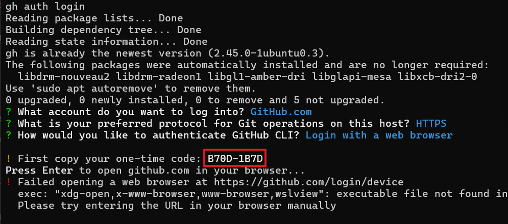
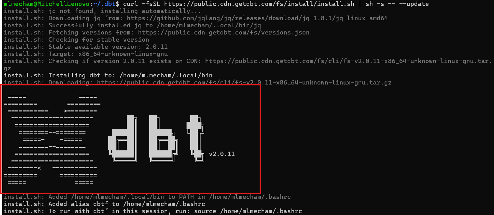
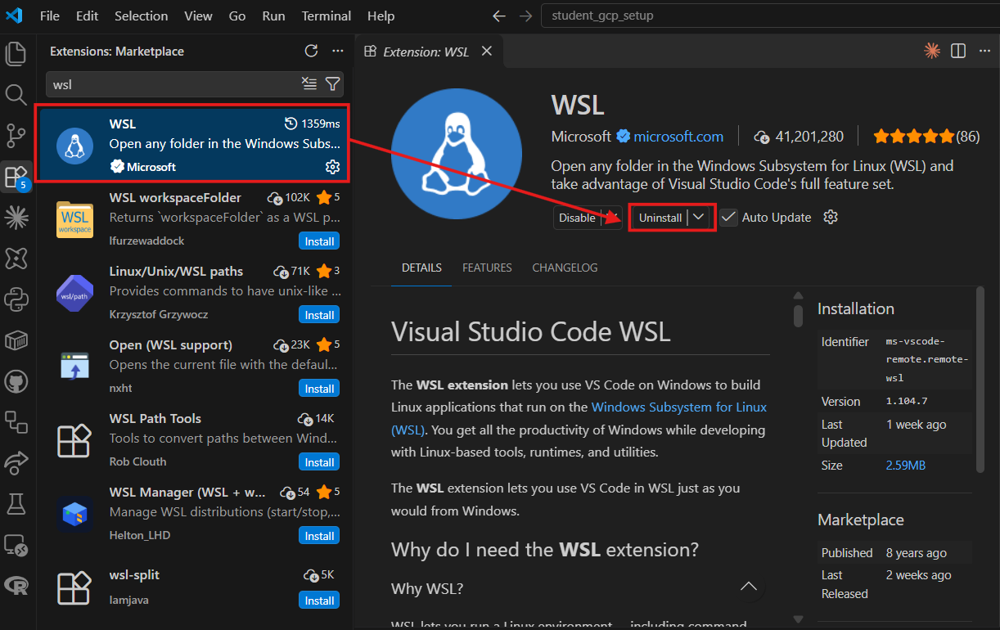
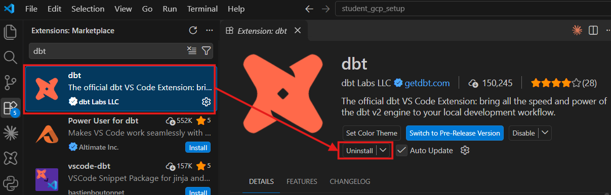

[← Home](../README.md) · **Page 0 of 7** · [Next: Fork, clone, push →](01_fork_clone_push.md)

# 0 · Install WSL + tools

**WSL** (Windows Subsystem for Linux) is a real Ubuntu Linux running inside Windows. Most
data teams work in Linux or on a Mac, and the dbt Labs workshop commands assume a Linux-style
terminal. Doing this today means workshop day is just dbt, with no setup.

| Part | What | Time |
|---|---|---|
| [A](#a--install-wsl) | Install WSL, restart | 10 min |
| [B](#b--first-launch-username--password) | Make your Linux username + password | 2 min |
| [C](#c--update-ubuntu) | Update Ubuntu | 3 min |
| [D](#d--point-linux-at-your-dbt-folder-symlink-first) | Symlink your `.dbt` folder (**do this before the dbt installs**) | 2 min |
| [E](#e--git--github) | Git name + GitHub login | 3 min |
| [F](#f--dbt-fusion) | dbt Fusion | 2 min |
| [G](#g--uv-optional) | uv (optional) | 1 min |
| [H](#h--vs-code--wsl) | VS Code + the dbt extension | 5 min |
| [✅](#-final-check) | Final check | 1 min |

> 🍎 **Mac?** Jump to [Mac users](#mac-users).

---

## A · Install WSL

1. Click **Start**, type **PowerShell**, **right-click** it → **Run as administrator** → **Yes**.
2. Run:

   ```powershell
   wsl --install
   ```

   This downloads Ubuntu (a few hundred MB). Let it finish.
3. When it says to, **restart your computer**.

> ⚠️ **It printed a help screen instead of installing?** WSL is half-installed already. Run
> `wsl --install -d Ubuntu`.
>
> ⚠️ **Error `0x80370102` or "enable Virtual Machine Platform"?** Virtualization is turned off
> in your BIOS. **Raise your hand.**
>
> ⚠️ **No admin rights?** **Raise your hand.** There's a Windows fallback in
> [Troubleshooting](troubleshooting.md#no-wsl-the-windows-fallback).

## B · First launch: username + password

After the restart an **Ubuntu** window opens by itself (if not: **Start → Ubuntu**). Wait for
*"Installing, this may take a few minutes..."*, then:

1. **Enter new UNIX username:** short, lowercase, no spaces. Example: `mitch`
2. **New password:** ⚠️ **Typing a password shows NOTHING.** No dots, no stars. That's
   normal. Type it and press Enter, then type it again.

**Write the password down.** You'll need it every time you run `sudo`.

✅ **Check:** you see a prompt like `mitch@LAPTOP-1234:~$`. That `~` means you're in your
Linux home folder.

> 🧠 **Linux vs. Windows paths:** in Ubuntu, your Windows `C:\` drive is at `/mnt/c/`.
> `C:\Users\Jane\.dbt` is `/mnt/c/Users/Jane/.dbt`.

## C · Update Ubuntu

```bash
sudo apt update && sudo apt upgrade -y
```

It asks for your password (invisible again). This takes a couple of minutes.

> 💡 `N: Some packages may have been kept back due to phasing` at the end? Harmless. Ubuntu
> rolls some updates out slowly. Keep going.

## D · Point Linux at your `.dbt` folder (symlink FIRST)

Your `profiles.yml` and `bigquery-key.json` already live in Windows, in `C:\Users\<you>\.dbt`.
Instead of making a **second** copy in Linux (confusing!), we make a **symlink**: a
shortcut that makes Linux's `~/.dbt` *be* your Windows `.dbt` folder.

**Do this before installing dbt**, so nothing creates an empty `~/.dbt` first.

1. Find your Windows username:

   ```bash
   ls /mnt/c/Users/
   ```

   You'll see something like:

   ```
   'All Users'   Default  'Default User'   Public   WsiAccount   desktop.ini   jane
   ```

   **Ignore** `All Users`, `Default`, `Default User`, `Public`, `WsiAccount`, and
   `desktop.ini`. Those are Windows system folders. **Yours is the one left over**
   (here, `jane`).

2. **Peek before you link.** Replace `jane` with yours, and keep the **`/Users/`** part:

   ```bash
   ls /mnt/c/Users/jane/.dbt
   ```

   ✅ You see `profiles.yml` and `bigquery-key.json`. If you get `No such file or directory`,
   check the spelling and make sure `/Users/` is in there (`/mnt/c/jane` ❌,
   `/mnt/c/Users/jane` ✅).

   > ⚠️ **Spelling is right, but there's still no `.dbt` folder?** You haven't done
   > [student_gcp_setup](https://github.com/MLMecham/student_gcp_setup) yet. Make the folder
   > now (`mkdir -p /mnt/c/Users/jane/.dbt`), finish this page, and **raise your hand** so we
   > can get your key into it.

3. Make the link (the **same path** you just peeked at):

   ```bash
   ln -s /mnt/c/Users/jane/.dbt ~/.dbt
   ```

   **Space in your Windows username?** Use quotes: `ln -s "/mnt/c/Users/Jane Doe/.dbt" ~/.dbt`

4. Check the link:

   ```bash
   ls -la ~ | grep .dbt
   ```

✅ **Check:** you see an **arrow**:
`.dbt -> /mnt/c/Users/jane/.dbt`. That arrow *is* the symlink. Now `ls ~/.dbt` shows the
same files as your Windows folder (`profiles.yml`, `bigquery-key.json`).

> 🧠 **Why doesn't plain `ls` show `.dbt`?** Names starting with a dot are **hidden** in
> Linux. `ls -a` shows them.

> ⚠️ **`ln: failed to create symbolic link: File exists`?** Something made a real `~/.dbt`
> first. Run `rmdir ~/.dbt` (this only works if it's empty, so it's safe), then redo step 3.
>
> ⚠️ **`ls ~/.dbt` is empty or "No such file"?** Wrong path in step 3. Run
> `rm ~/.dbt` (this deletes only the link, not your files) and redo steps 2–3.

## E · Git + GitHub

Ubuntu already has `git`. Tell it who you are (**use the email on your GitHub account**):

```bash
git config --global user.name "Your Name"
git config --global user.email "you@example.com"
```

Now log in to GitHub with the **GitHub CLI** (`gh`), so `git push` just works:

```bash
sudo apt install -y gh
gh auth login
```

Answer the questions with the arrow keys + Enter:

| Question | Answer |
|---|---|
| Where do you use GitHub? | **GitHub.com** |
| Preferred protocol? | **HTTPS** |
| Authenticate Git with your GitHub credentials? | **Yes** |
| How would you like to authenticate? | **Login with a web browser** |

It shows a **one-time code** (like `ABCD-1234`). Copy it, then press Enter.



**`Failed opening a web browser` is normal in WSL.** Linux can't open your Windows browser.
Open <https://github.com/login/device> in your normal Windows browser yourself, paste the
code, and approve.

✅ **Check:** `gh auth status` says **Logged in to github.com**.

## F · dbt Fusion

**Fusion** is dbt Labs' new engine, the one the workshop uses. It's a single program, not a
Python package, so there's no `pip` and no `uv sync` for it.

```bash
curl -fsSL https://public.cdn.getdbt.com/fs/install/install.sh | sh -s -- --update
```

Success looks like this: a big **dbt** logo, then **`Added alias dbtf`** at the bottom.



The installer adds a shortcut called `dbtf`, but **only for new terminals**. Load it now:

```bash
source ~/.bashrc
dbtf --version
```

✅ **Check:** it prints `dbt 2.x.x`.

> ### 🪤 Gotcha: `dbt` works but `dbtf` doesn't
> `dbt` and `dbtf` are **the same program**. `dbtf` is just a nickname (an *alias*) that the
> installer writes into `~/.bashrc`.
>
> | You see | Why | Fix |
> |---|---|---|
> | `dbtf: command not found`, but `dbt --version` says **2.x** | Terminal opened before the install | `source ~/.bashrc`, or open a new terminal |
> | Still not found in a new terminal | Alias didn't get saved | `echo "alias dbtf=~/.local/bin/dbt" >> ~/.bashrc && source ~/.bashrc` |
> | `dbt --version` says **1.x** | That's **old dbt-core** (Python), not Fusion, usually from an active `.venv` | Run `deactivate`, then use `dbtf` |
>
> **Use `dbtf` everywhere today.** It always means Fusion.

## G · uv (optional)

This repo doesn't need Python at all (Fusion isn't Python). But if you ever want your **class
project** (`uv run dbt ...`) to run in WSL too, grab uv now:

```bash
curl -LsSf https://astral.sh/uv/install.sh | sh
source ~/.bashrc
uv --version
```

## H · VS Code + WSL

VS Code stays installed on **Windows**. One extension lets it reach into Linux.

1. In VS Code (Windows): **Extensions** (`Ctrl+Shift+X`) → search **WSL** → install the one by
   **Microsoft** (blue check ✔).

   

2. **While you're in Extensions, check for the dbt extension:** search **dbt**. The right one
   is called just **dbt**, by **dbt Labs LLC** with the blue check ✔. **Not** "Power User for
   dbt" and **not** "vscode-dbt".

   

   Installed already (it says **Uninstall**)? 👍 Not installed? Click **Install**. Either way
   you'll still install it **into WSL** in step 4: Windows and WSL keep separate extension
   lists.

3. Back in the **Ubuntu** terminal:

   ```bash
   code .
   ```

   The first time, it installs a small "VS Code Server" in Linux (about 1 min). A VS Code window
   opens.

✅ **Check:** the **bottom-left corner** of VS Code says **`WSL: Ubuntu`**.

4. Install the **dbt extension** *into WSL*: in this new window, **Extensions** → search
   **dbt** → the same **dbt Labs LLC** one → click **Install in WSL: Ubuntu**.
5. When it asks you to **register**, use your **university email**. (Not prompted?
   `Ctrl+Shift+P` → type `register` → **dbt: Register dbt extension**.)

> 💡 Your Windows extensions don't automatically exist in WSL. If an extension says
> **"Install in WSL: Ubuntu"**, that's why.

## ✅ Final check

Paste this whole block into the Ubuntu terminal:

```bash
git --version
gh auth status
dbtf --version
ls ~/.dbt
```

You should see: a git version, **Logged in to github.com**, **dbt 2.x.x**, and
**profiles.yml + bigquery-key.json**. All four? You're done with setup. 🎉

---

## Mac users

No WSL needed. Open **Terminal** and do:

- **E**, but install `gh` with `brew install gh` (no Homebrew? <https://brew.sh>)
- **F** exactly as written (on a Mac, use `source ~/.zshrc` instead of `~/.bashrc`)
- **H**, skipping the WSL extension: just install the dbt extension and register
- **Skip D.** Your `~/.dbt` is already the real folder.

---

[← Home](../README.md) · **Page 0 of 7** · [Next: Fork, clone, push →](01_fork_clone_push.md)
