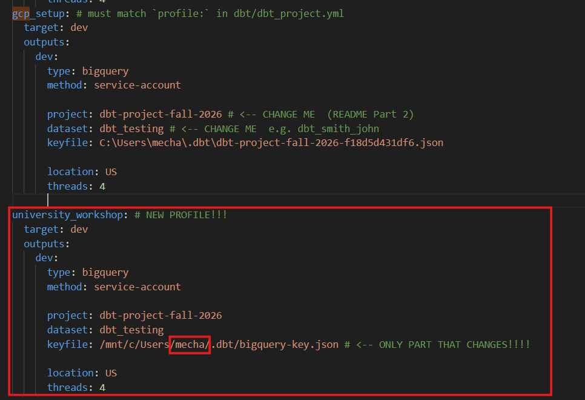
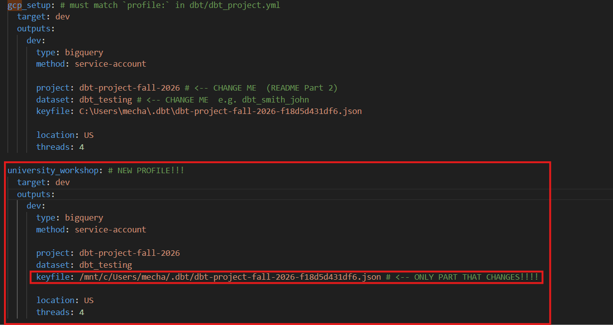
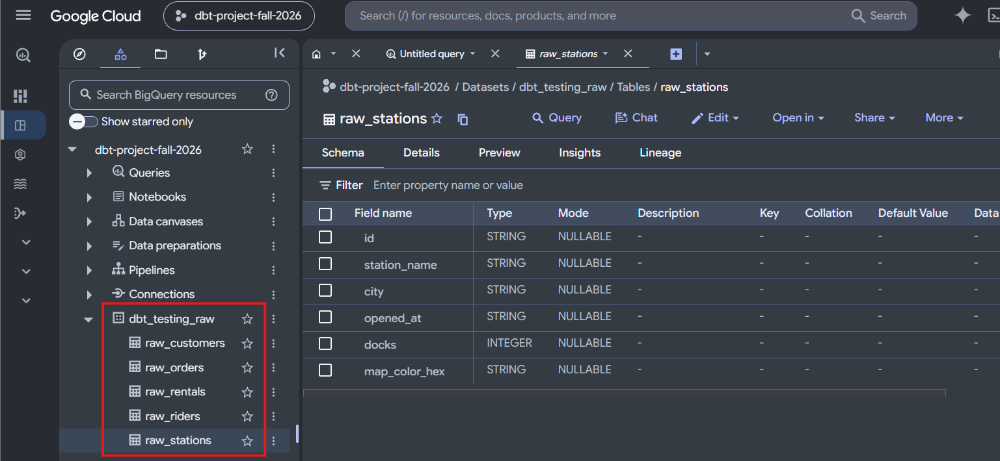

[← Back: Fork, clone, push](01_fork_clone_push.md) · **Page 2 of 7** · [Next: Sources →](03_sources.md)

# 2 · Profile + seed

## 1 · Add a profile block

This repo's `dbt_project.yml` says `profile: university_workshop`. That's the **same name the
workshop starter repo uses**, so the block you make now works on workshop day too.

### 1a · Get your exact keyfile path first (don't guess it!)

```bash
readlink -e ~/.dbt/*.json   # prints the REAL Linux path to your key. Copy this whole line.
```

It prints something like `/mnt/c/Users/jane/.dbt/bigquery-key.json`. **Copy it.** You'll
paste it in 1b. Your key might have a different name (like
`dbt-project-fall-2026-a1b2c3.json`). That's fine: this command finds it either way.

Prints nothing? There's no key in `.dbt` yet. Go back to
[student_gcp_setup](https://github.com/MLMecham/student_gcp_setup).

### 1b · Add the block

Open your profiles file. Thanks to the symlink, this **is** your Windows file:

```bash
code ~/.dbt/profiles.yml
```

**Keep everything that's already there.** Paste this at the **bottom**, then replace the three
`<...>` placeholders:

```yaml
university_workshop:
  target: dev
  outputs:
    dev:
      type: bigquery
      method: service-account

      project: <same project as your gcp_setup block>
      dataset: <same dataset as your gcp_setup block>
      keyfile: <paste what readlink printed in 1a>

      location: US
      threads: 4
```

Copy `project:` and `dataset:` from your existing `gcp_setup:` block. **Don't copy its
`keyfile:` line.** The keyfile is the **only** line that's different:



If your key has a longer name, your keyfile line looks like this instead. Same idea:



> ### Why a new block instead of reusing `gcp_setup`?
> Your `gcp_setup` keyfile is a **Windows** path (`C:\Users\...`). Linux can't read `C:\`
> paths. Same key file, two ways to spell where it is:
>
> | Block | Used from | keyfile |
> |---|---|---|
> | `gcp_setup` | Windows (class project) | `C:\Users\Jane\.dbt\bigquery-key.json` |
> | `university_workshop` | WSL (today + workshop) | `/mnt/c/Users/Jane/.dbt/bigquery-key.json` |

Save the file.

## 2 · `dbtf debug`

In the VS Code terminal (`` Ctrl+` ``), from the repo folder:

```bash
dbtf debug
```

✅ **Check:** **All checks passed!**

<details>
<summary>⚠️ It failed?</summary>

| Error says | Fix |
|---|---|
| profile **not found** / `university_workshop` | Block name typo, or you pasted it *inside* another block. It must start at the far left, with no spaces. |
| **keyfile** / does not exist | Wrong path or wrong file name (yours might not be `bigquery-key.json`). Run `readlink -e ~/.dbt/*.json` and paste exactly what it prints. |
| **location** / dataset not found in location | `location:` must match `gcp_setup` (usually `US`). |
| `dbtf: command not found` | See the [dbtf gotcha](00_wsl.md#f--dbt-fusion). |

</details>

## 3 · `dbtf deps`

```bash
dbtf deps
```

This installs **dbt_utils**, a package of handy macros (listed in `packages.yml`). We use it
to build `dim_date`. dbt packages are dbt code, not Python, so there's still no `uv`.

## 4 · `dbtf seed`

```bash
dbtf seed
```

✅ **Check:** `3 total | 3 success`.

> 💡 You'll also see `[warning] UnusedResourceConfigPath ... models.byui_bike_dbt.staging`.
> That's fine. `dbt_project.yml` has settings for a `staging/` folder that's still empty.
> The warning goes away once you build staging models.

## 5 · Go look at the raw data

In the **BigQuery console** (<https://console.cloud.google.com/bigquery>), your project now
has a dataset called **`<your dataset>_raw`** (example: `dbt_smith_john_raw`) with
`raw_rentals`, `raw_riders`, and `raw_stations`. (Can't see it? Click the ⋮ next to your
project → **Refresh**.)



> 💡 Also see `raw_customers` and `raw_orders`? Those are from student_gcp_setup, which used
> the same `_raw` dataset. That's fine. Ignore them.

Click **raw_riders** → **Preview**.

Or stay in VS Code. Seeds can be `ref`'d, so `dbtf show` can peek at them:

```bash
dbtf show --select raw_riders
```

**Three things to notice:**

1. 😬 **`ssn`** is right there. Social Security numbers (fake ones, starting `000`). Staging
   is where we make sure they **never go any further**.
2. **Duplicate rows.** Run this:

   ```bash
   dbtf show --inline "select id, count(*) as copies from {{ ref('raw_riders') }} group by id having count(*) > 1"
   ```

   Three riders were loaded twice: `R-1009`, `R-1023`, and `R-1030`.
3. **Two Jordan Smiths:**

   ```bash
   dbtf show --inline "select * from {{ ref('raw_riders') }} where full_name = 'Jordan Smith'"
   ```

   Same name, but a **different `id`** and a different signup date. **Are these duplicates?**
   🤔 Remember your answer for page 4.

> ⚠️ **`dbtf show --inline` tip:** don't put `limit` in your SQL (it errors). Use the
> `--limit` flag instead: `dbtf show --inline "select ..." --limit 20`

---

[← Back: Fork, clone, push](01_fork_clone_push.md) · **Page 2 of 7** · [Next: Sources →](03_sources.md)
