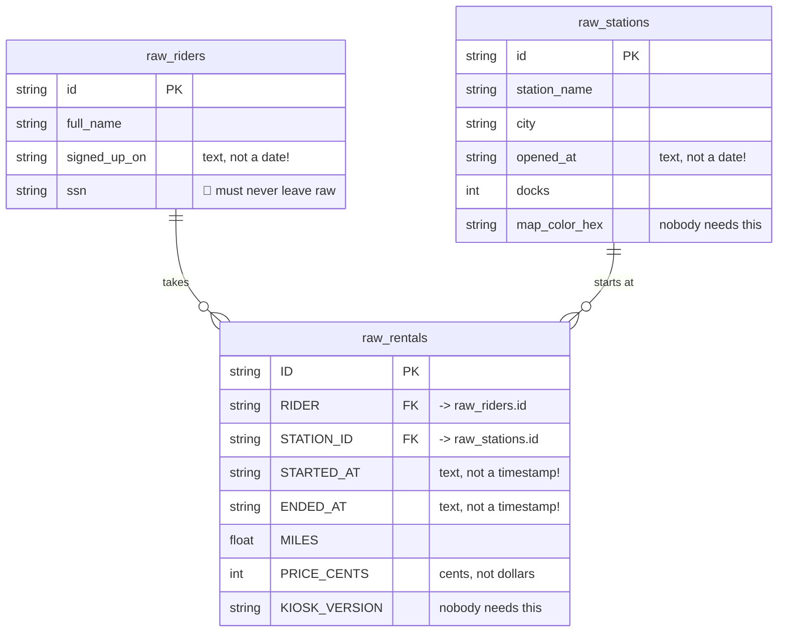

[← Back: Profile + seed](02_profile_and_seed.md) · **Page 3 of 7** · [Next: Staging →](04_staging.md)

# 3 · Sources

## Pretend these CSVs came from the bike app

In real life, nobody hands you CSVs. The bike company's **app** has its own database: every
time someone unlocks a bike, the app writes **one row**. That kind of database is called
**OLTP** (Online *Transaction* Processing). It's built for lots of tiny writes, and nobody
designed it for analysis.

Our seeds play the role of a copy of that app database. Here's how its tables connect:



Notice the mess: dates stored as text, **SHOUTING** column names in one table, cents instead of
dollars, junk columns, duplicate rows, and an SSN. Staging cleans all of that up (page 4).

## `source()` vs `ref()`

| | `{{ source('bike_raw', 'raw_riders') }}` | `{{ ref('stg_riders') }}` |
|---|---|---|
| Points at | a table **dbt didn't build** (loaded by someone else) | a model **dbt builds** |
| Used in | **staging** only | everything after staging |
| Declared in | a `_sources.yml` file | nothing extra: the `.sql` file *is* the declaration |

> 🧠 Seeds technically *can* be `ref`'d (you did it on page 2). But in a real project, raw
> data is loaded by a tool like Fivetran, not by dbt. So we treat the raw tables like the real
> thing and use **`source()`**. That's also what you'll do at the workshop.

## Your turn: make `models/staging/_sources.yml`

Create the file **`models/staging/_sources.yml`** and fill in the blanks:

```yaml
sources:
  - name: bike_raw
    description: "Raw bike-rental tables, loaded with dbtf seed."
    schema: "{{ target.schema }}_raw"
    tables:
      - name: ________
      - name: ________
      - name: ________
```

**What's `schema: "{{ target.schema }}_raw"`?** `target.schema` is the `dataset:` from your
profile (example: `dbt_smith_john`). `dbtf seed` put the CSVs in `dbt_smith_john_raw`. This
line builds that name for **every** student automatically, so nobody has to hard-code their
own dataset.

### ✅ Check

```bash
dbtf show --inline "select * from {{ source('bike_raw', 'raw_stations') }}"
```

You should see 7 rows. (Wait, aren't there only 6 stations? 🤔 Look at `ST-03`.)

<details>
<summary>▶ Solution: <code>models/staging/_sources.yml</code></summary>

```yaml
sources:
  - name: bike_raw
    description: "Raw bike-rental tables, loaded with dbtf seed."
    schema: "{{ target.schema }}_raw"
    tables:
      - name: raw_rentals
      - name: raw_riders
      - name: raw_stations
```

</details>

---

[← Back: Profile + seed](02_profile_and_seed.md) · **Page 3 of 7** · [Next: Staging →](04_staging.md)
