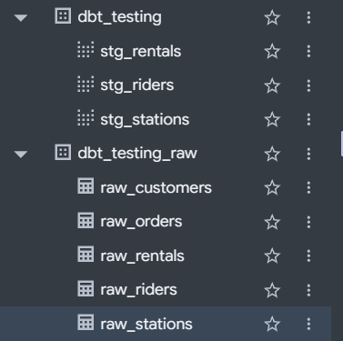

[← Back: Sources](03_sources.md) · **Page 4 of 7** · [Next: Dims + fact →](05_marts.md)

# 4 · Staging

**One staging model per source table.** Each one does the same four moves:

| Move | Example | Why |
|---|---|---|
| **Rename** | `RIDER` → `rider_id` | Clear, consistent names everywhere downstream |
| **Cast** (only what needs it) | `'2026-06-01 09:15:00'` (text) → timestamp | So date math works |
| **Dedup** | keep 1 row per `id` | So counts and joins aren't doubled |
| **New column** | `ride_minutes` | Simple, row-level logic everyone will want |

…plus **drop what nobody should use**: junk columns and the **SSN**.

> 🎯 **Finishing this page is today's goal.**

## First: make the three staging files

The repo doesn't come with any staging models. You write them. Make three empty files in
`models/staging/` (next to your `_sources.yml`):

```bash
touch models/staging/stg_riders.sql models/staging/stg_stations.sql models/staging/stg_rentals.sql   # creates 3 empty files
ls models/staging/                                                                                   # check they're there
```

✅ **Check:** you see `_sources.yml`, `stg_rentals.sql`, `stg_riders.sql`, `stg_stations.sql`.

(Prefer clicking? In the VS Code Explorer, right-click **`staging`** → **New File...** → type
the name. Do it three times.)

> 🧠 **Naming convention:** `stg_` + the table name without `raw_`. One staging model per
> source table, always.

> 💡 dbt **ignores empty files**, so it's fine to leave two empty while you work on the
> first. They'll start building once they have SQL in them.

---

## Dedup with `QUALIFY`: the same as Snowflake

You did this in Snowflake. **BigQuery uses the exact same syntax:**

<table>
<tr><th>Snowflake (class project)</th><th>BigQuery (today)</th></tr>
<tr><td>

```sql
select *
from source
qualify row_number() over (
    partition by id
    order by signed_up_on
) = 1
```

</td><td>

```sql
select *
from source
qualify row_number() over (
    partition by id
    order by signed_up_on
) = 1
```

</td></tr>
</table>

Yes, they're identical. What it does, using rider `R-1009` (loaded twice):

| id | full_name | `row_number() over (partition by id ...)` | kept? |
|---|---|---|---|
| R-1009 | Marcus Reed | **1** | ✅ |
| R-1009 | Marcus Reed | **2** | ❌ |
| R-1017 | Jordan Smith | **1** | ✅ |
| R-1042 | Jordan Smith | **1** | ✅ |

`partition by id` restarts the count for every `id`. `= 1` keeps the first row of each group.

> ⚠️ **Both Jordan Smiths get `1`** because they have **different ids**. They're two
> different people who happen to share a name. **Always dedup on the primary key, never on a
> name.** (A test on page 6 checks that both survive.)

<details>
<summary>▶ What QUALIFY is short for (the long way)</summary>

`QUALIFY` is a filter on a window function, so you don't need a subquery:

```sql
select * except (rn)
from (
    select *, row_number() over (partition by id order by signed_up_on) as rn
    from source
)
where rn = 1
```

</details>

## BigQuery casting cheat sheet

> 📘 **New to SQL types?** Read the 5-minute
> [SQL data types + casting primer](sql_types_and_casting.md) first. It explains *why*
> `'10' < '9'` is true.

| From (text) | To | BigQuery |
|---|---|---|
| `'2026-06-01 09:15:00'` | timestamp | `cast(STARTED_AT as timestamp)` |
| `'2026-03-14'` | date | `cast(signed_up_on as date)` |
| `'2025-04-15T00:00:00'` | date | `date(cast(opened_at as timestamp))` |
| `1350` (cents) | dollars | `PRICE_CENTS / 100` |
| timestamp | date | `date(started_at)` |
| two timestamps | minutes between | `timestamp_diff(ended_at, started_at, minute)` |
| `a / b` where `b` might be 0 | no crash | `safe_divide(a, b)` |
| `'Jordan Smith'` | `'Jordan'` | `split(full_name, ' ')[offset(0)]` |

> 🧠 **Column names in BigQuery aren't case-sensitive.** `ID`, `id`, and `Id` all work. We
> still rename the SHOUTING ones so everything downstream looks the same.

---

## Model 1 · `stg_riders` (guided)

Open **`models/staging/stg_riders.sql`**, paste this in, and fill in the `____` blanks:

```sql
with source as (

    select * from {{ source('bike_raw', '____') }}

),

deduped as (

    select *
    from source
    qualify row_number() over (partition by ____ order by signed_up_on) = 1

),

renamed as (

    select
        id                                  as ____,          -- rename
        full_name,
        split(full_name, ' ')[offset(0)]    as first_name,    -- new column
        cast(signed_up_on as ____)          as signed_up_on   -- cast
        -- ssn: ????
    from deduped

)

select * from renamed
```

Build and check it:

```bash
dbtf run --select stg_riders
dbtf show --select stg_riders
```

✅ **Check:** there's **no `ssn` column**, and both Jordan Smiths are there:

```bash
dbtf show --inline "select * from {{ ref('stg_riders') }} where full_name = 'Jordan Smith'"
```

<details>
<summary>▶ Solution: <code>stg_riders.sql</code></summary>

```sql
with source as (

    select * from {{ source('bike_raw', 'raw_riders') }}

),

deduped as (

    -- dedup on the PRIMARY KEY (id), never on the name: there are two Jordan Smiths!
    select *
    from source
    qualify row_number() over (partition by id order by signed_up_on) = 1

),

renamed as (

    select
        id                                  as rider_id,      -- rename
        full_name,
        split(full_name, ' ')[offset(0)]    as first_name,    -- new column
        cast(signed_up_on as date)          as signed_up_on   -- cast
        -- ssn is NOT selected. It stops here.
    from deduped

)

select * from renamed
```

</details>

---

## Model 2 · `stg_stations` (your turn)

Open **`models/staging/stg_stations.sql`**. Same shape as `stg_riders`. Here's the spec:

| Raw column | Do this | Output column |
|---|---|---|
| `id` | rename | `station_id` |
| `station_name` | keep | `station_name` |
| `city` | keep | `city` |
| `opened_at` | cast text → **date** | `opened_on` |
| `docks` | keep (already a number: **no cast needed**) | `docks` |
| *(new)* | `docks >= 20` | `is_large_station` |
| `map_color_hex` | **drop** | — |

Dedup on `id` (remember `ST-03` showed up twice).

Start from this skeleton. It's the same 3 CTEs as `stg_riders`: **source → deduped →
renamed**. Use the table above to fill in the `____` blanks:

```sql
with source as (

    -- 1. grab the raw table
    select * from {{ source('bike_raw', '____') }}

),

deduped as (

    -- 2. keep one row per id
    select *
    from source
    qualify row_number() over (partition by ____ order by opened_at) = 1

),

renamed as (

    -- 3. rename, cast, add new columns. Only list the columns you KEEP.
    select
        ____                                as station_id,
        station_name,
        city,
        date(cast(____ as timestamp))       as opened_on,
        ____,
        ____ >= 20                          as is_large_station
    from deduped

)

select * from renamed
```

```bash
dbtf run --select stg_stations
dbtf show --select stg_stations
```

✅ **Check:** **6** rows, not 7.

<details>
<summary>▶ Solution: <code>stg_stations.sql</code></summary>

```sql
with source as (

    select * from {{ source('bike_raw', 'raw_stations') }}

),

deduped as (

    select *
    from source
    qualify row_number() over (partition by id order by opened_at) = 1

),

renamed as (

    select
        id                                  as station_id,        -- rename
        station_name,
        city,
        date(cast(opened_at as timestamp))  as opened_on,         -- cast: text -> timestamp -> date
        docks,                                                    -- already a number: no cast
        docks >= 20                         as is_large_station   -- new column
        -- map_color_hex: nobody needs it, so it's gone
    from deduped

)

select * from renamed
```

</details>

---

## Model 3 · `stg_rentals` (your turn, the big one)

Open **`models/staging/stg_rentals.sql`**. This table has SHOUTING column names:

| Raw column | Do this | Output column |
|---|---|---|
| `ID` | rename | `rental_id` |
| `RIDER` | rename | `rider_id` |
| `STATION_ID` | rename | `station_id` |
| `STARTED_AT` | cast text → **timestamp** | `started_at` |
| `ENDED_AT` | cast text → **timestamp** | `ended_at` |
| `MILES` | keep (already a number) | `miles` |
| `PRICE_CENTS` | ÷ 100 | `price_dollars` |
| `KIOSK_VERSION` | **drop** | — |
| *(new)* | date of `started_at` | `rental_date` |
| *(new)* | minutes between start and end | `ride_minutes` |
| *(new)* | miles ÷ hours | `mph` |

Dedup on `ID`.

This one has a **4th CTE**, `final`. The new columns need the timestamps **after** they've
been cast, so they're calculated from `renamed`. Fill in the `____` blanks:

```sql
with source as (

    -- 1. grab the raw table
    select * from {{ source('bike_raw', '____') }}

),

deduped as (

    -- 2. keep one row per ID
    select *
    from source
    qualify row_number() over (partition by ____ order by STARTED_AT) = 1

),

renamed as (

    -- 3. rename + cast. Only list the columns you KEEP.
    select
        ID                                  as rental_id,
        RIDER                               as ____,
        STATION_ID                          as ____,
        cast(STARTED_AT as ____)            as started_at,
        cast(ENDED_AT as ____)              as ended_at,
        MILES                               as miles,
        PRICE_CENTS / ____                  as price_dollars
    from deduped

),

final as (

    -- 4. new columns, built from the clean columns in `renamed`
    select
        *,
        date(started_at)                              as rental_date,
        timestamp_diff(____, ____, minute)            as ride_minutes,
        round(safe_divide(miles, timestamp_diff(ended_at, started_at, minute) / 60), 1) as mph
    from renamed

)

select * from final
```

> 💡 **`timestamp_diff(later, earlier, minute)`**: the later time goes first.

```bash
dbtf run --select stg_rentals
dbtf show --select stg_rentals
```

✅ **Check:** **215** rows (the raw table had 221).

```bash
dbtf show --inline "select count(*) as n from {{ ref('stg_rentals') }}"
```

<details>
<summary>▶ Solution: <code>stg_rentals.sql</code></summary>

```sql
with source as (

    select * from {{ source('bike_raw', 'raw_rentals') }}

),

deduped as (

    select *
    from source
    qualify row_number() over (partition by ID order by STARTED_AT) = 1

),

renamed as (

    select
        ID                                  as rental_id,     -- rename
        RIDER                               as rider_id,      -- rename
        STATION_ID                          as station_id,
        cast(STARTED_AT as timestamp)       as started_at,    -- cast
        cast(ENDED_AT as timestamp)         as ended_at,      -- cast
        MILES                               as miles,
        PRICE_CENTS / 100                   as price_dollars  -- cents -> dollars
        -- KIOSK_VERSION: dropped
    from deduped

),

final as (

    select
        *,
        date(started_at)                              as rental_date,   -- new column
        timestamp_diff(ended_at, started_at, minute)  as ride_minutes,  -- new column
        round(safe_divide(miles, timestamp_diff(ended_at, started_at, minute) / 60), 1) as mph
    from renamed

)

select * from final
```

</details>

---

## 🎉 Staging done

Run all three together:

```bash
dbtf run --select staging
```

✅ **Check:** `3 total | 3 success`. In BigQuery, refresh your project. Your **own** dataset
(no `_raw`) now has three `stg_` **views** (the dotted icon means *view*, not table):



**Commit + push** (Source Control → message → Commit →
**Sync Changes**).

That's today's goal. If you have time, keep going. 👇

---

[← Back: Sources](03_sources.md) · **Page 4 of 7** · [Next: Dims + fact →](05_marts.md)
