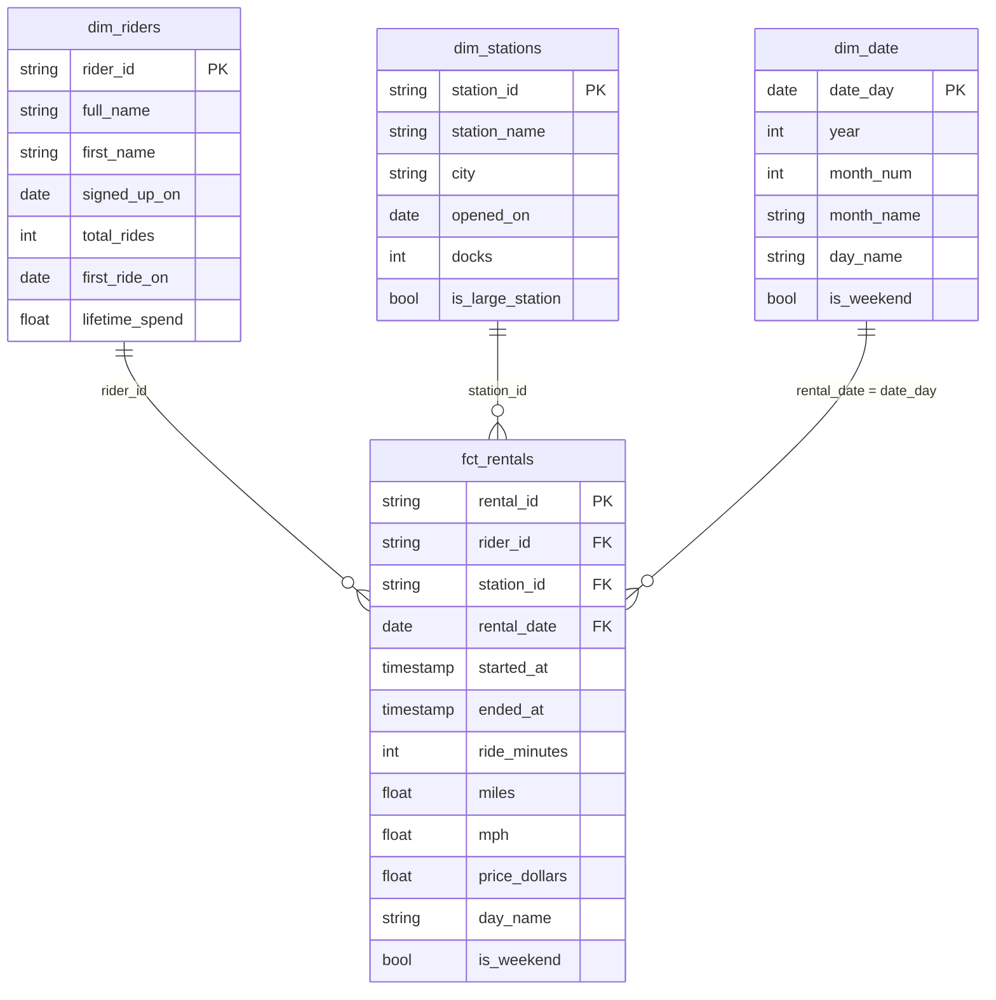

[← Back: Staging](04_staging.md) · **Page 5 of 7** · [Next: Tests →](06_tests.md)

# 5 · Dims + fact

## From OLTP to OLAP

The raw tables were shaped for the **app** (OLTP). Now we reshape them for **analysis**:
**OLAP** (Online *Analytical* Processing). The classic OLAP shape is a **star schema**: one
**fact** table of events in the middle, with **dimension** tables around it that describe
the who, where, and when.



| | **Fact** (`fct_`) | **Dimension** (`dim_`) |
|---|---|---|
| One row per | **event** (a rental) | **thing** (a rider, a station, a day) |
| Mostly | numbers you add up + foreign keys | descriptions you filter and group by |
| Grows | fast (every ride) | slowly |

Marts are built as **tables** (staging was views). `dbt_project.yml` already sets that up.

---

## 🎁 `dim_date` is free

Open **`models/marts/dim_date.sql`**. It's already written. It uses `dbt_utils.date_spine`
(from the package you installed with `dbtf deps`) to make one row per day of 2026.

```bash
dbtf run --select dim_date
dbtf show --select dim_date
```

---

## First: make the three mart files

`dim_date.sql` is already in `models/marts/`. Add the other three:

```bash
touch models/marts/dim_stations.sql models/marts/dim_riders.sql models/marts/fct_rentals.sql   # creates 3 empty files
ls models/marts/                                                                               # check they're there
```

✅ **Check:** you see `dim_date.sql`, `dim_riders.sql`, `dim_stations.sql`, `fct_rentals.sql`.

> ⚠️ **Each model goes in its own file.** Before you paste anything, check the **tab name** at
> the top of VS Code matches the model you're working on. Pasting `dim_riders` code into
> `dim_stations.sql` is the #1 mistake on this page: everything "builds", then the tests fail
> with `Unrecognized name: station_id`.

## Model 1 · `dim_stations` (easy)

Open **`models/marts/dim_stations.sql`**. Select every column from `stg_stations`, using
**`ref`** this time (not `source`). Fill in the blanks:

```sql
select
    station_id,
    ____,
    ____,
    opened_on,
    ____,
    is_large_station
from {{ ref('____') }}
```

(Not sure what the columns are? `dbtf show --select stg_stations --limit 3`)

<details>
<summary>▶ Solution (paste into <code>dim_stations.sql</code> only)</summary>

```sql
select
    station_id,
    station_name,
    city,
    opened_on,
    docks,
    is_large_station
from {{ ref('stg_stations') }}
```

**Why not `select *`?** Listing the columns makes the dim's "contract" obvious. If someone
adds a column to staging, it doesn't silently show up here.

</details>

## Model 2 · `dim_riders` (a join!)

Every rider, plus their ride totals. **Join** riders to a summary of their rentals. Open
**`models/marts/dim_riders.sql`** and fill in the blanks:

```sql
with riders as (

    select * from {{ ref('____') }}

),

rentals as (

    select * from {{ ref('____') }}

),

rider_totals as (

    select
        rider_id,
        count(*)            as total_rides,
        min(rental_date)    as first_ride_on,
        sum(price_dollars)  as lifetime_spend
    from rentals
    group by ____

)

select
    riders.rider_id,
    riders.full_name,
    riders.first_name,
    riders.signed_up_on,
    coalesce(rider_totals.total_rides, 0)    as total_rides,
    rider_totals.first_ride_on,
    coalesce(rider_totals.lifetime_spend, 0) as lifetime_spend
from riders
____ join rider_totals
    on riders.rider_id = rider_totals.rider_id
```

🤔 **`left` or `inner` join?** What should happen to a rider who signed up but never rode?

<details>
<summary>▶ Solution (paste into <code>dim_riders.sql</code> only)</summary>

```sql
with riders as (

    select * from {{ ref('stg_riders') }}

),

rentals as (

    select * from {{ ref('stg_rentals') }}

),

rider_totals as (

    select
        rider_id,
        count(*)            as total_rides,
        min(rental_date)    as first_ride_on,
        sum(price_dollars)  as lifetime_spend
    from rentals
    group by rider_id

)

select
    riders.rider_id,
    riders.full_name,
    riders.first_name,
    riders.signed_up_on,
    coalesce(rider_totals.total_rides, 0)    as total_rides,
    rider_totals.first_ride_on,
    coalesce(rider_totals.lifetime_spend, 0) as lifetime_spend
from riders
left join rider_totals
    on riders.rider_id = rider_totals.rider_id
```

**`left` join**, because a dimension should list **every** rider, even ones with 0 rides.
That's also why there's a `coalesce(..., 0)`.

</details>

## Model 3 · `fct_rentals` (the middle of the star)

Open **`models/marts/fct_rentals.sql`**: every column from `stg_rentals`, **plus** `day_name`
and `is_weekend` from `dim_date`.

**Hint:** join `stg_rentals.rental_date` to `dim_date.date_day`.

<details>
<summary>▶ Solution (paste into <code>fct_rentals.sql</code> only)</summary>

```sql
with rentals as (

    select * from {{ ref('stg_rentals') }}

),

dates as (

    select * from {{ ref('dim_date') }}

)

select
    rentals.rental_id,
    rentals.rider_id,       -- foreign key -> dim_riders
    rentals.station_id,     -- foreign key -> dim_stations
    rentals.rental_date,    -- foreign key -> dim_date
    rentals.started_at,
    rentals.ended_at,
    rentals.ride_minutes,
    rentals.miles,
    rentals.mph,
    rentals.price_dollars,
    dates.day_name,
    dates.is_weekend
from rentals
left join dates
    on rentals.rental_date = dates.date_day
```

</details>

---

## Build them

```bash
dbtf run --select marts
```

✅ **Check:** `4 total | 4 success`. Then see who rides the most:

```bash
dbtf show --inline "select full_name, total_rides, lifetime_spend from {{ ref('dim_riders') }} order by total_rides desc" --limit 5
```

Now look at the fastest rides:

```bash
dbtf show --inline "select rental_id, rider_id, miles, ride_minutes, mph from {{ ref('fct_rentals') }} order by mph desc" --limit 5
```

…**over 9,000 mph on a bike?** Hold that thought. The next page builds a test to catch exactly this.

**Commit + push.**

---

[← Back: Staging](04_staging.md) · **Page 5 of 7** · [Next: Tests →](06_tests.md)
